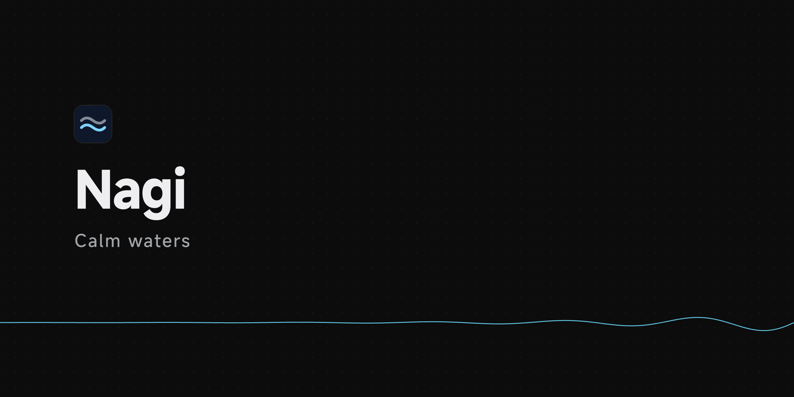

<p align="center"></p>

<p align="center">
  <a href="LICENSE"></a>
  
  
  <a href="https://github.com/SIPC/Nagi/releases/latest"></a>
</p>

<p align="center"><a href="README.md">简体中文</a> · <b>English</b></p>

# Nagi (凪)

> Calm waters.

Nagi is an open-source, self-hosted container deployment platform: one web panel to manage Docker containers across many Linux servers. It is built on Docker and Docker Compose, supports multiple nodes and high availability, and aims to be simple, good-looking and easy to deploy.

<picture>
  <source media="(prefers-color-scheme: dark)" srcset="docs/assets/screenshots/overview.en.dark.png">
  
</picture>

The panel UI is available in English and Chinese. The [design docs](docs/README.md) are in Chinese.

## How it works

- **Built on Docker Compose**: every app is a standard compose file plus environment variables and secrets. A single container created from the image form also gets a generated compose file. Deployments, versions and rollbacks all work per compose file, and Nagi never rewrites your compose files.
- **One panel, many nodes**: the panel is the web console and holds project configuration. Nodes are the servers that run containers; they connect out to the panel, so no inbound ports are needed. The panel has a built-in node by default, so a single server is enough to start.
- **Nodes form a network automatically**: nodes are connected by encrypted WireGuard links, and containers in the same project reach each other by name, whichever server they run on.
- **Public access**: Caddy is built in. Bind a domain and HTTPS certificates are issued automatically, or open TCP / UDP ports directly.
- **Data protection**: per-container scheduled snapshots with kopia, which can be synced to another node as an off-site copy. When a node fails, a node chosen in advance can take over automatically.
- **A single program**: written in Go. The panel and nodes are the same program, data lives in a built-in SQLite database, and nothing is needed besides Docker.

### Core concepts

| Concept | Meaning |
| --- | --- |
| Node | A Linux server running the Nagi node program. Containers run on nodes |
| Project | A group of containers that work together, such as a frontend, a backend and a database. Projects live on the panel, and their containers can be spread across nodes. Projects are isolated from each other by default |
| Container | The unit deployed on its own within a project: a single container, or a container group defined by one compose file. Each is deployed, rolled back, snapshotted and migrated on its own |

## Interface

**Projects**: a group of containers that work together, spread across nodes, deployed and monitored in one place.

<picture>
  <source media="(prefers-color-scheme: dark)" srcset="docs/assets/screenshots/project.en.dark.png">
  
</picture>

**Containers**: every container has its own page with its status, resource usage, versions and recent events.

<picture>
  <source media="(prefers-color-scheme: dark)" srcset="docs/assets/screenshots/container.en.dark.png">
  
</picture>

**Nodes**: CPU, memory and disk usage of every server.

<picture>
  <source media="(prefers-color-scheme: dark)" srcset="docs/assets/screenshots/nodes.en.dark.png">
  
</picture>

**Node network**: how nodes connect to each other and the latency between them, direct or relayed through the panel.

<picture>
  <source media="(prefers-color-scheme: dark)" srcset="docs/assets/screenshots/network.en.dark.png">
  
</picture>

## Features

### Multi-node and high availability


Also included:

- Snapshots: scheduled per-container backup and restore, with an optional backup node as an off-site replica; move containers between nodes without losing data; redeploy containers to another node if a node is lost for good
- Primary and standby panels, and handing nodes over between panels
- Node terminal and files: no SSH needed, admins only, identity verified first, every action logged, can be turned off on the node

### Basics


Also included:

- Logs, terminal, monitoring and alerts (webhook, Telegram); alerts are still sent while the panel is offline
- Environment variables at three levels (project, container group, container), secrets, private registry credentials, health checks and resource limits
- Image update notices and registry mirrors for nodes in mainland China
- Projects are isolated by default and can be linked to each other on demand
- Panel security: optional two-factor authentication, login rate limiting and a secure entry path; one-click panel updates and node upgrades

### Not supported yet

Automatic scheduling, multiple replicas of one container, several panels managing the same node, restore drills, adopting existing projects, building images on nodes, and app templates. Cross-node traffic between containers is limited to TCP and unicast UDP.

## Quick start

Run as root on a Linux server to install the panel (with an embedded node, so one server is enough):

```bash
curl -fsSL https://github.com/SIPC/Nagi/releases/latest/download/install.sh | sudo sh
```

When it finishes, open the setup link it prints in a browser to create the admin account.

See the [guides](docs/guide/README.en.md) for more:

- [Install the panel](docs/guide/install.en.md)
- [Add a node](docs/guide/add-node.en.md)
- [Add a standby panel](docs/guide/standby.en.md)
- [Upgrade and uninstall](docs/guide/upgrade.en.md)
- [Switch panels](docs/guide/migrate-panel.en.md)

## Requirements

- Linux (amd64 / arm64); systemd recommended
- Docker with the compose plugin 2.24 or later (installed by the install script)
- Ports to open:

| Port | Protocol | Purpose |
| --- | --- | --- |
| Panel port | TCP, UDP | Web console and node connections; must be reachable from browsers and all nodes. UDP is used for WireGuard relaying |
| 80, 443 | TCP | Project domains and certificate issuance; only on nodes that serve projects by domain |
| Node WireGuard port | UDP | Direct node-to-node traffic, picked at random on first start; relayed through the panel if blocked |

Ports you open for containers in the UI must also be allowed on the corresponding nodes.

## Development

See the [design docs](docs/README.md) for each module and the [development guide](docs/development.md#本地开发) for building from source and local development (both in Chinese).

## Security

Please do not report security issues in public issues; see [SECURITY.md](SECURITY.md) for how to report them.

## Acknowledgements

Nagi is built on these open-source projects:

- [Caddy](https://github.com/caddyserver/caddy) and [caddy-l4](https://github.com/mholt/caddy-l4): external access, automatic HTTPS and TCP / UDP forwarding
- [wireguard-go](https://git.zx2c4.com/wireguard-go): the encrypted network between nodes
- [Hysteria](https://github.com/apernet/hysteria) and [quic-go](https://github.com/quic-go/quic-go): the QUIC fast path and BBR congestion control
- [kopia](https://github.com/kopia/kopia): snapshots and off-site replicas
- [yamux](https://github.com/hashicorp/yamux) and [Connect](https://connectrpc.com): control-plane communication
- [shadcn/ui](https://ui.shadcn.com): UI components
- [MiSans](https://hyperos.mi.com/font): interface font, by Xiaomi

## License

[Apache-2.0](LICENSE)
