<p align="center">
  <picture>
    <source media="(prefers-color-scheme: dark)" srcset="docs/assets/hero.dark.png">
    
  </picture>
</p>

<p align="center">
  <a href="LICENSE"></a>
  
  
  <a href="https://github.com/SIPC/Nagi/releases/latest"></a>
</p>

<p align="center"><a href="README.md">简体中文</a> · <b>English</b></p>

# Nagi

Nagi is an open-source, self-hosted container deployment platform. Manage Docker containers across many Linux servers from one web panel, with multiple nodes and high availability.

<picture>
  <source media="(prefers-color-scheme: dark)" srcset="docs/assets/screenshots/overview.en.dark.png">
  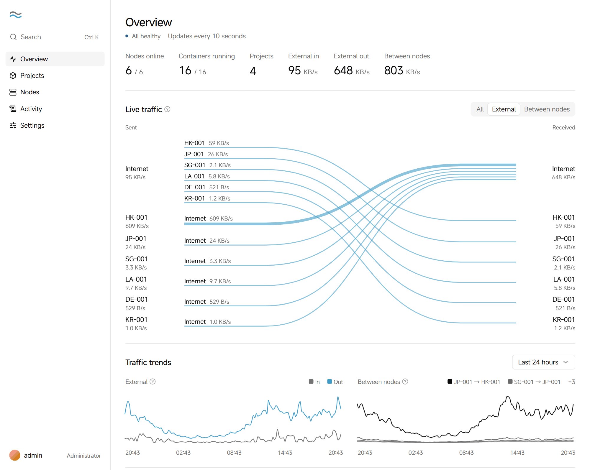
</picture>

The panel is available in English and Chinese. The [design docs](docs/README.md) are in Chinese.

## How it works

- **Built on Docker Compose**: every app is a standard compose file. Deployments, versions and rollbacks all work per compose file.
- **One panel, many nodes**: nodes connect out to the panel, so they don't need inbound ports. The panel includes a built-in node, so one server is enough to start.
- **Node network**: nodes connect to each other over encrypted WireGuard links, and containers in a project reach each other by name across nodes.
- **Public access**: Caddy is built in. Bind a domain and HTTPS is set up automatically, or open TCP and UDP ports directly.
- **Data protection**: scheduled per-container snapshots can be synced to another node. When a node fails, a failover node you choose takes over.
- **A single program**: the panel and nodes are the same Go program. Data is stored in a built-in SQLite database, and Docker is the only dependency.

### Core concepts

| Concept | Meaning |
| --- | --- |
| Node | A Linux server that runs containers |
| Project | A group of containers that work together and can run across nodes. Projects are isolated from each other by default |
| Container | The unit you deploy: a single container, or a container group defined by one compose file. Each one is deployed, rolled back, snapshotted and moved on its own |

## Interface

**Projects**: deploy and monitor the containers in a project in one place.

<picture>
  <source media="(prefers-color-scheme: dark)" srcset="docs/assets/screenshots/project.en.dark.png">
  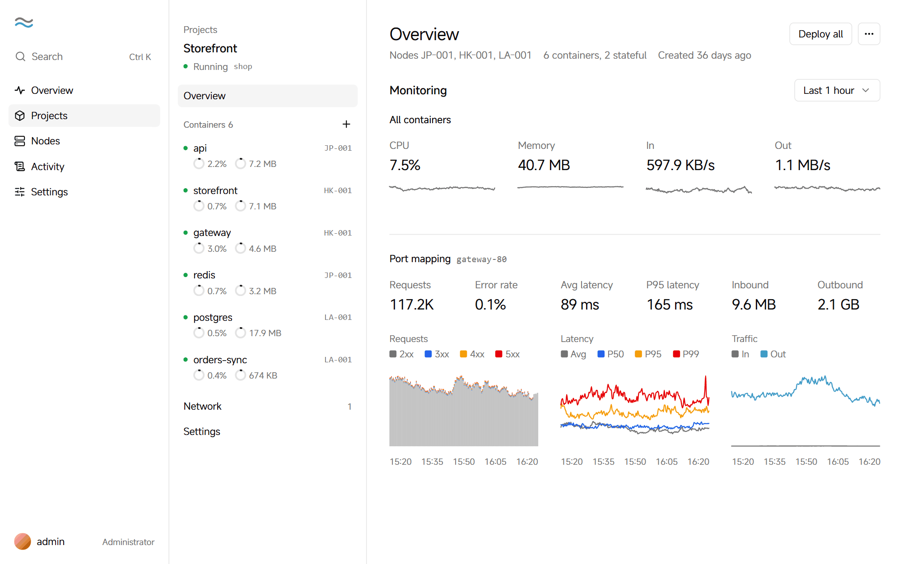
</picture>

**Containers**: see the status, resource usage, versions and recent events.

<picture>
  <source media="(prefers-color-scheme: dark)" srcset="docs/assets/screenshots/container.en.dark.png">
  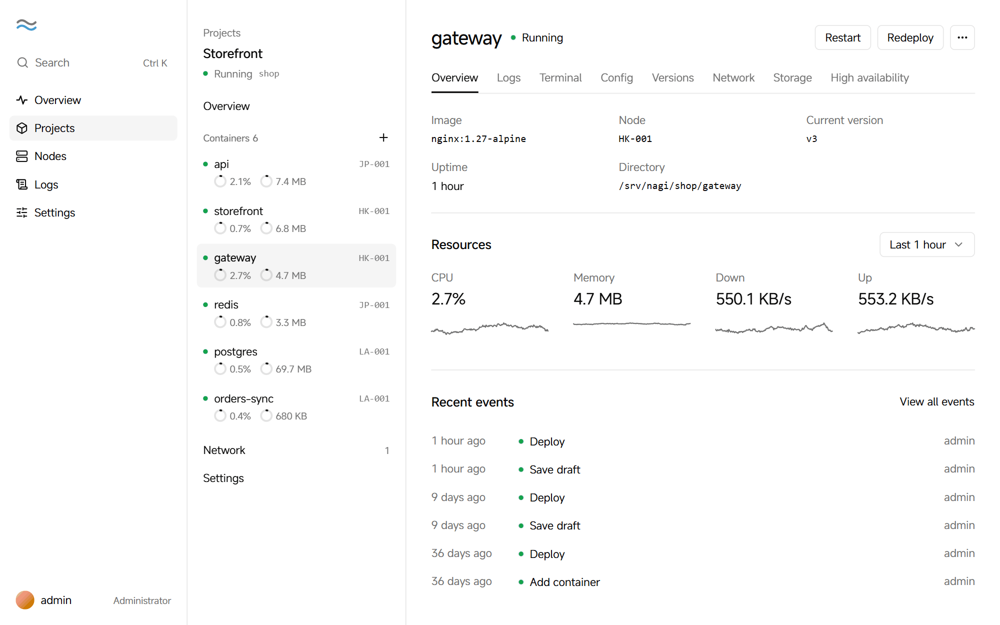
</picture>

**Nodes**: see the CPU, memory and disk usage of every server.

<picture>
  <source media="(prefers-color-scheme: dark)" srcset="docs/assets/screenshots/nodes.en.dark.png">
  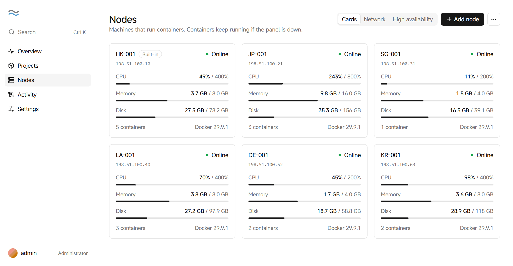
</picture>

**Node network**: see how nodes connect and the latency between them.

<picture>
  <source media="(prefers-color-scheme: dark)" srcset="docs/assets/screenshots/network.en.dark.png">
  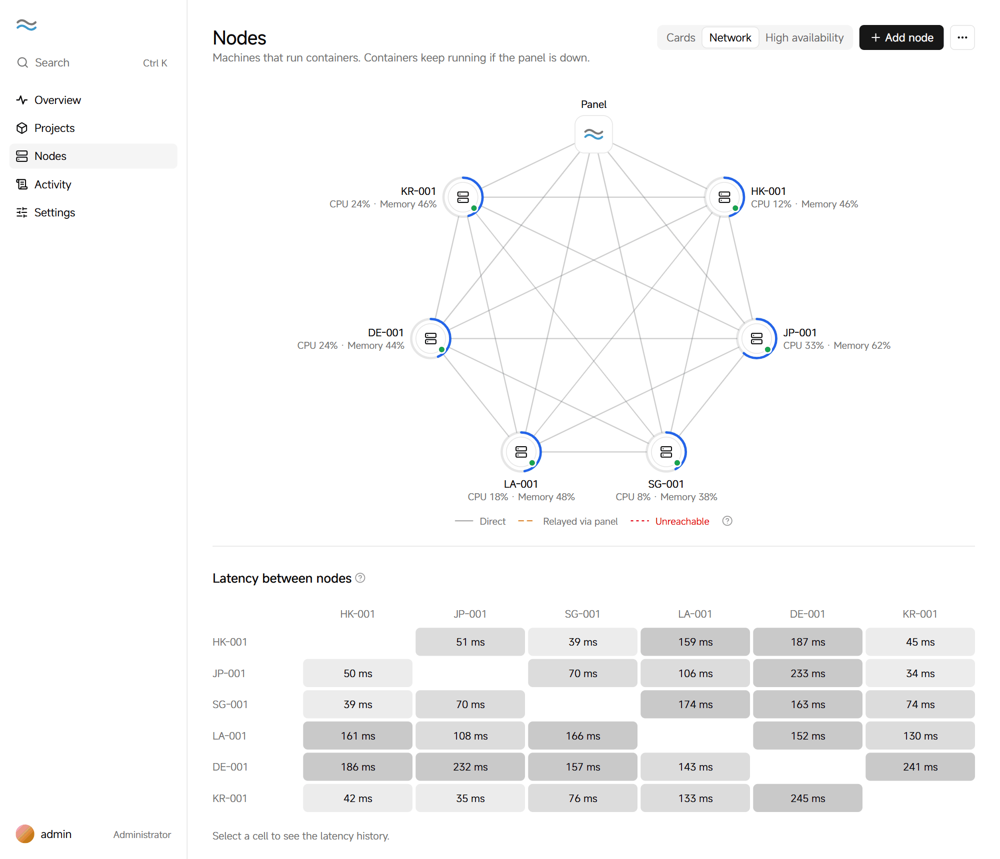
</picture>

## Features

### Multi-node and high availability

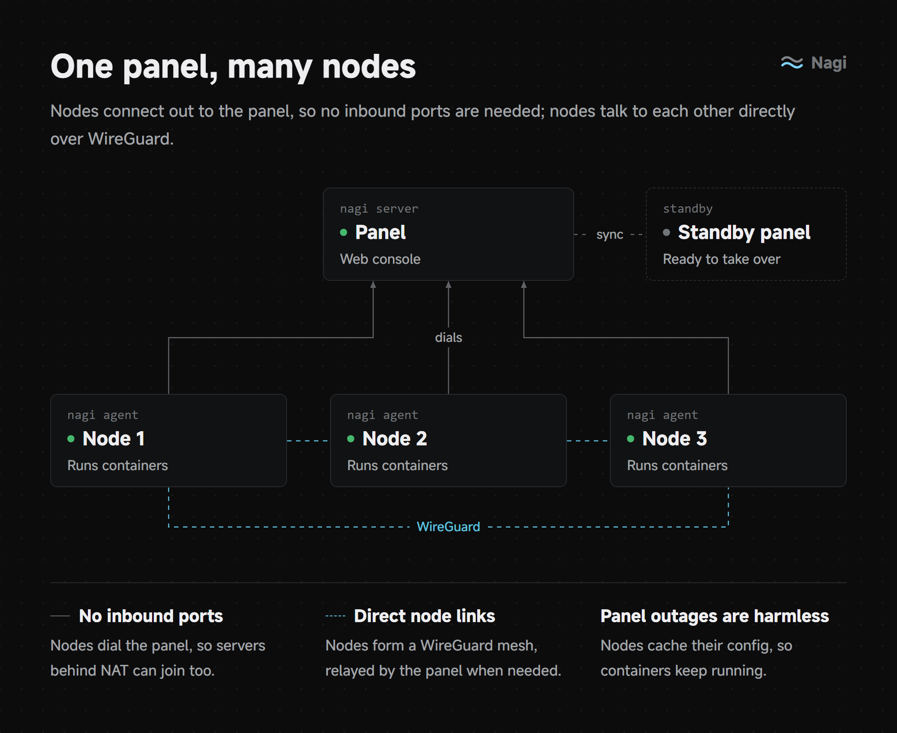

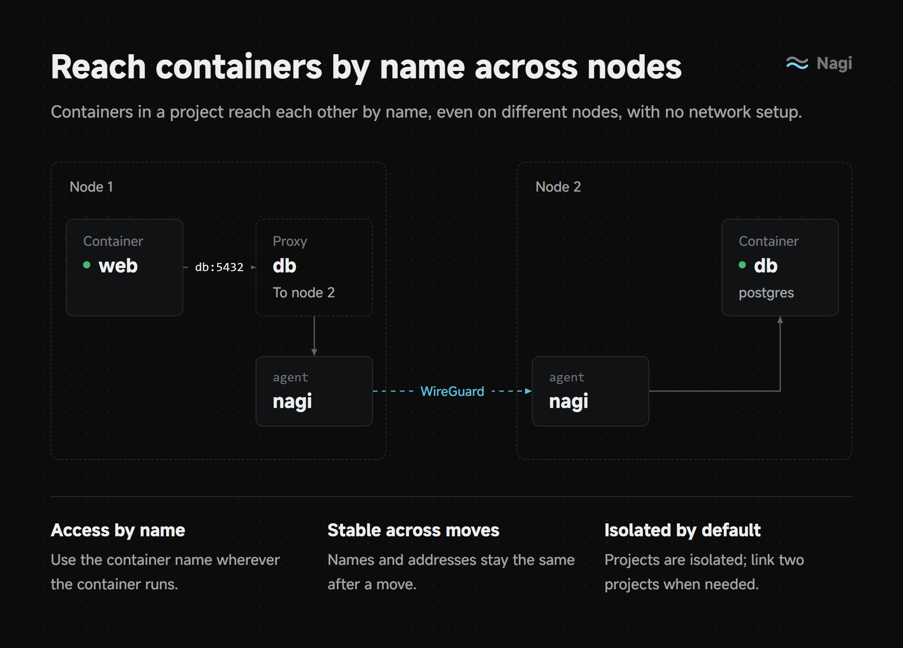

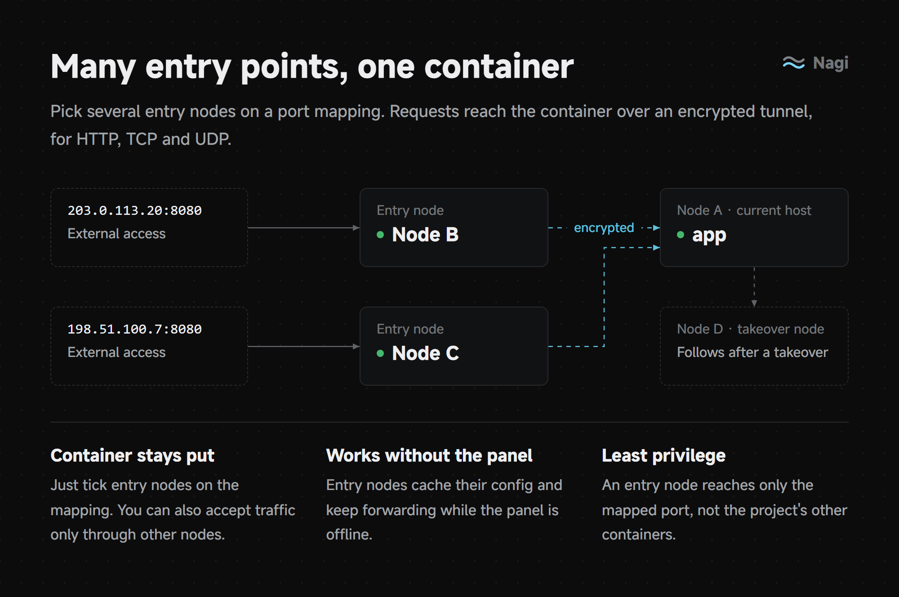

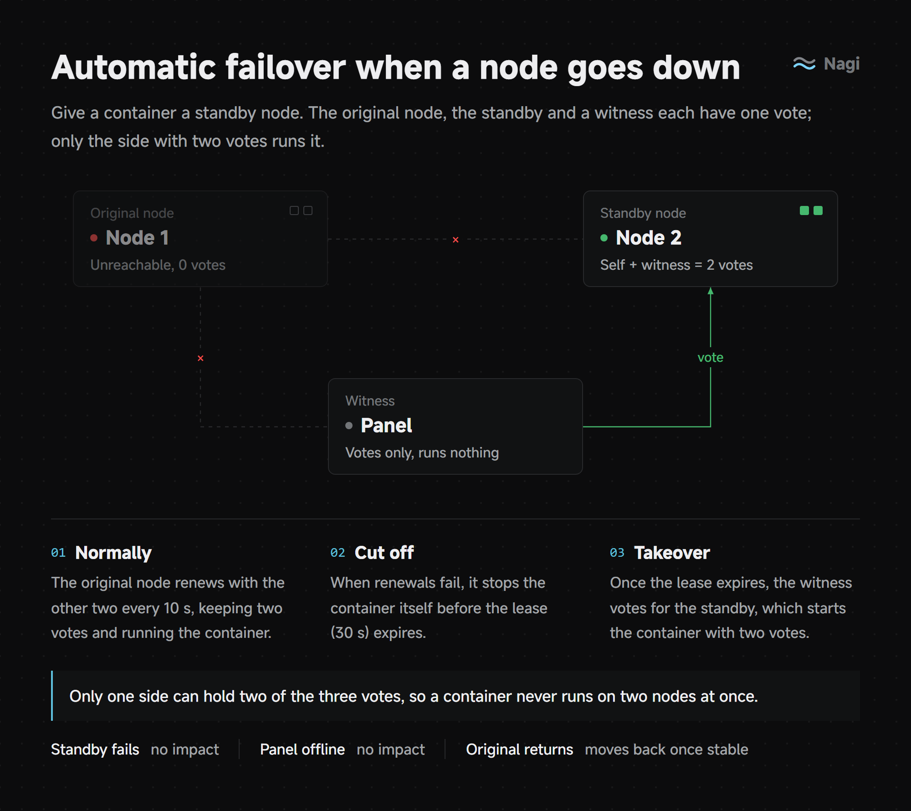

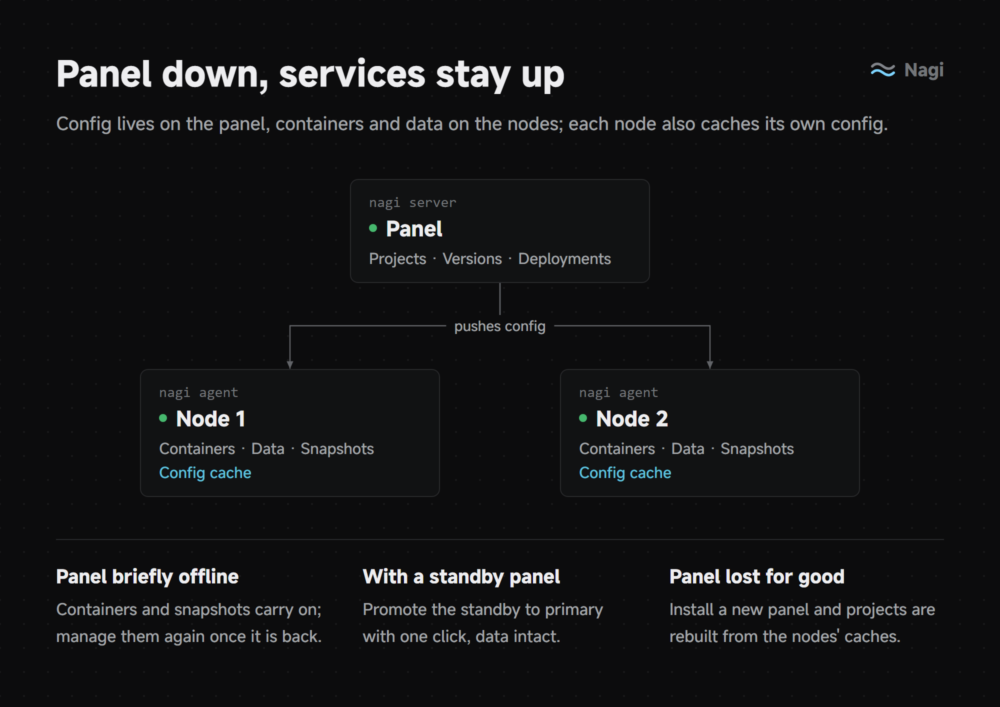

Also included:

- Container snapshots and restore, with backups kept on another node
- Moving containers between nodes along with their data
- Redeploying containers to another node when a node can't be recovered
- Primary and standby panels, and handing nodes over between panels
- Node terminal and files without SSH, for administrators only and recorded in Activity

### Basics

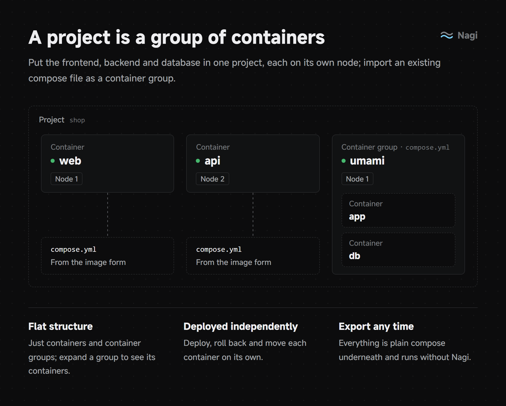

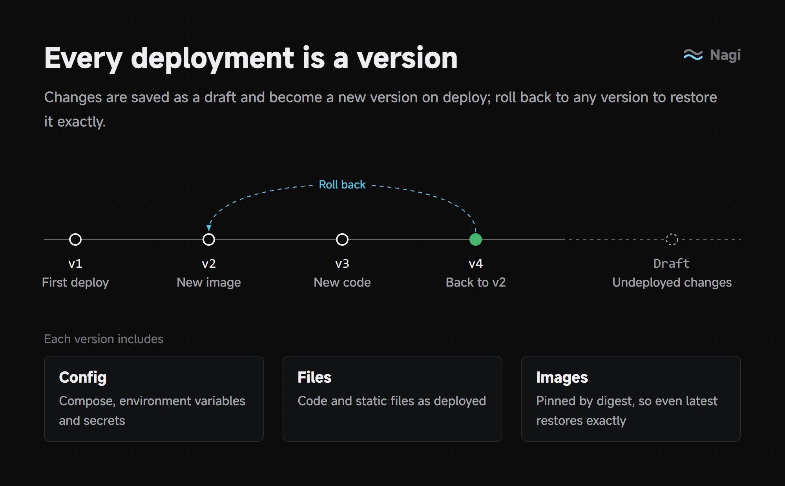

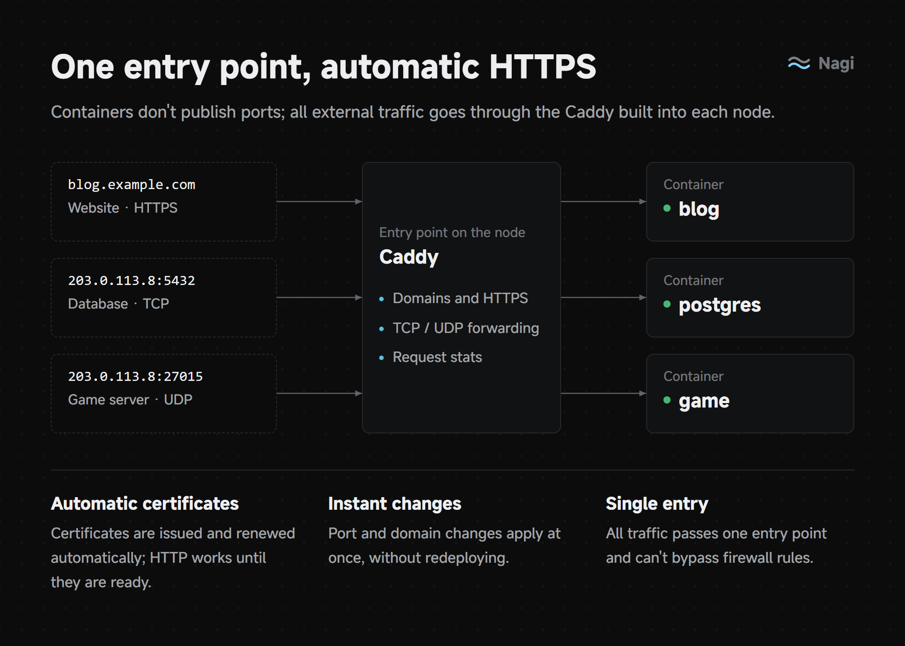

Also included:

- Logs, terminal, monitoring and alerts, with alerts sent even while the panel is offline
- Environment variables and secrets, private registries, health checks and resource limits
- Image update notices and registry mirrors for nodes in mainland China
- Links between projects
- Two-factor authentication, login rate limiting and a secure entry
- Panel updates and node upgrades from the panel

## Quick start

Run this command as root on a Linux server to install the panel:

```bash
curl -fsSL https://github.com/SIPC/Nagi/releases/latest/download/install.sh | sudo sh
```

When the installation finishes, open the setup link it prints in a browser and create the administrator account.

For step-by-step instructions, see the [guides](docs/guide/README.en.md):

- [Install the panel](docs/guide/install.en.md)
- [Add a node](docs/guide/add-node.en.md)
- [Add a standby panel](docs/guide/standby.en.md)
- [Upgrade and uninstall](docs/guide/upgrade.en.md)
- [Switch panels](docs/guide/migrate-panel.en.md)

## Requirements

- Linux (amd64 / arm64); systemd recommended
- Docker with the compose plugin 2.24 or later, which the install script installs
- These open ports:

| Port | Protocol | Purpose |
| --- | --- | --- |
| Panel port | TCP, UDP | Web console and node connections; must be reachable from browsers and all nodes. UDP carries relayed node traffic |
| 80, 443 | TCP | Project domains and certificates; only on nodes that serve projects by domain |
| Node WireGuard port | UDP | Direct node-to-node traffic, picked at random on first start; relayed through the panel if blocked |

Ports you open for containers must also be allowed on their nodes.

## Development

See the [design docs](docs/README.md) for each module and the [development guide](docs/development.md#本地开发) for building and local development (both in Chinese).

## Security

Don't report security issues in public issues. See [SECURITY.md](SECURITY.md) for how to report them.

## Acknowledgements

Nagi is built on these open-source projects:

- [Caddy](https://github.com/caddyserver/caddy) and [caddy-l4](https://github.com/mholt/caddy-l4): external access, automatic HTTPS and TCP / UDP forwarding
- [wireguard-go](https://git.zx2c4.com/wireguard-go): the encrypted network between nodes
- [Hysteria](https://github.com/apernet/hysteria) and [quic-go](https://github.com/quic-go/quic-go): the QUIC fast path and BBR congestion control
- [kopia](https://github.com/kopia/kopia): snapshots and off-site replicas
- [yamux](https://github.com/hashicorp/yamux) and [Connect](https://connectrpc.com): control-plane communication
- [shadcn/ui](https://ui.shadcn.com): UI components
- [MiSans](https://hyperos.mi.com/font): interface font, by Xiaomi

## License

[Apache-2.0](LICENSE)

## Star history

<a href="https://star-history.com/#SIPC/Nagi&Date">
  <picture>
    <source media="(prefers-color-scheme: dark)" srcset="https://api.star-history.com/svg?repos=SIPC/Nagi&type=Date&theme=dark">
    
  </picture>
</a>
