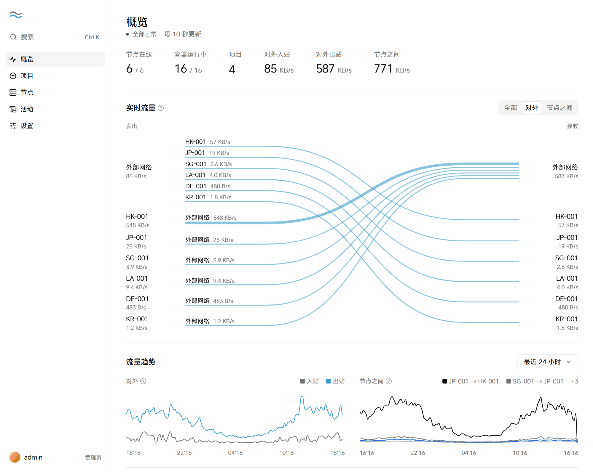
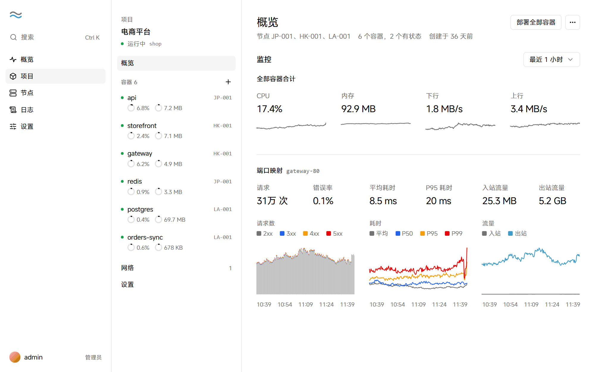
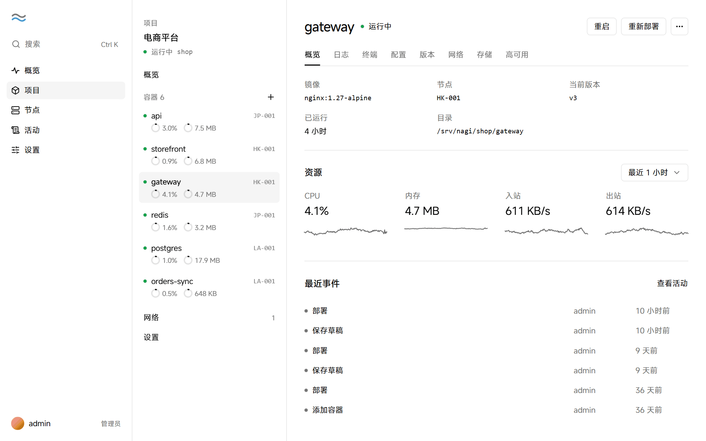
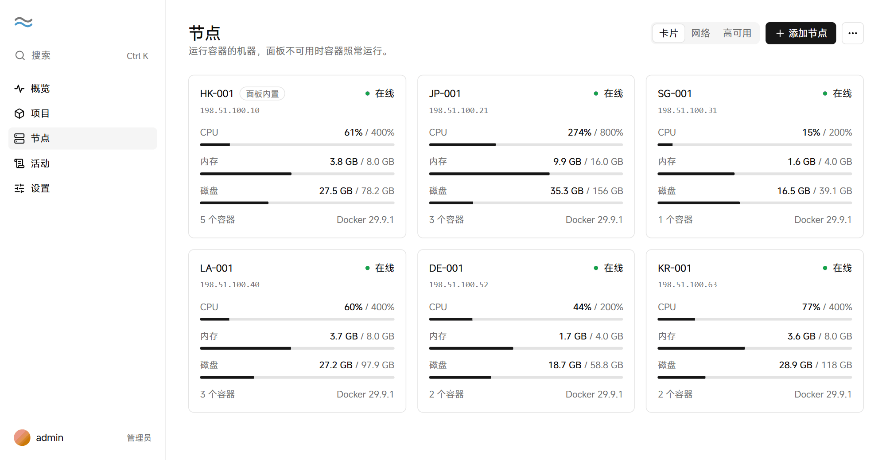
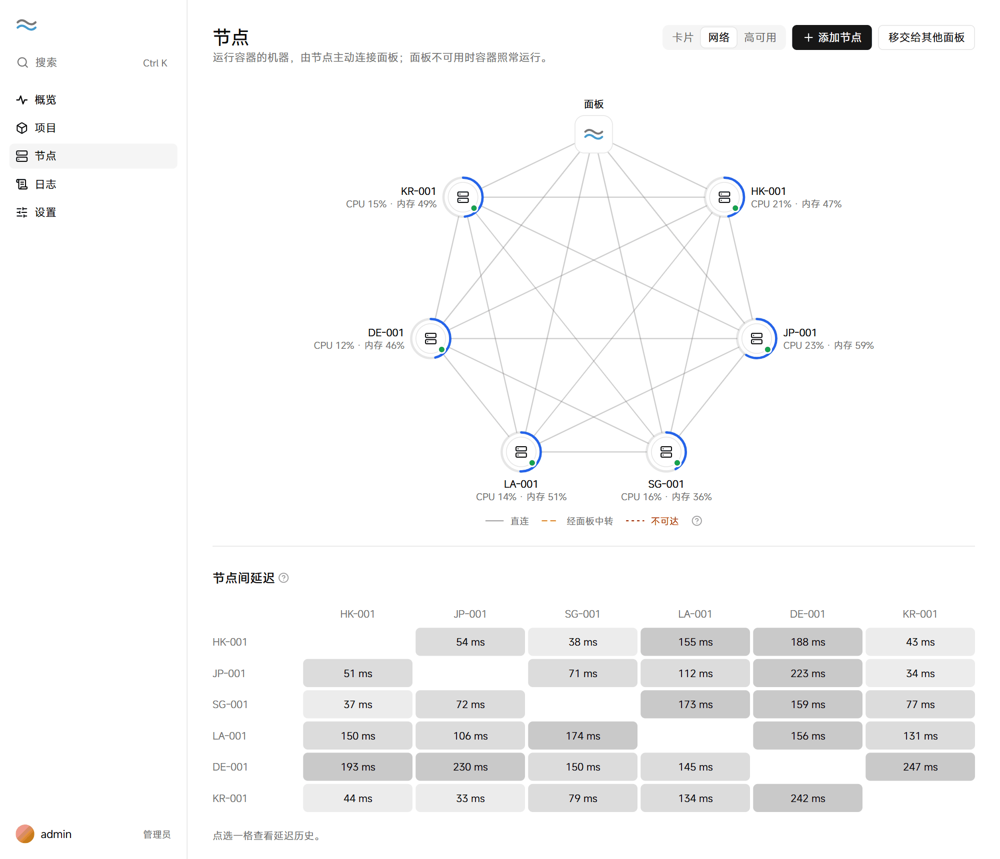

<p align="center">
  <picture>
    <source media="(prefers-color-scheme: dark)" srcset="docs/assets/hero.dark.png">
    
  </picture>
</p>

<p align="center">
  <a href="LICENSE"></a>
  
  
  <a href="https://github.com/SIPC/Nagi/releases/latest"></a>
</p>

<p align="center"><b>简体中文</b> · <a href="README.en.md">English</a></p>

# Nagi

Nagi 是开源、自托管的容器部署平台。在一个网页面板上管理多台 Linux 服务器上的 Docker 容器，支持多节点与高可用。

<picture>
  <source media="(prefers-color-scheme: dark)" srcset="docs/assets/screenshots/overview.dark.png">
  
</picture>

## 工作方式

- **基于 Docker Compose**：每个应用是一份标准的 compose 文件，部署、版本和回滚都以它为单位。
- **一个面板，多个节点**：节点主动连接面板，无需开放入站端口。面板内嵌一个节点，一台服务器即可使用。
- **节点网络**：节点之间通过 WireGuard 加密互联，同一项目的容器可以跨节点按名称访问。
- **对外访问**：内置 Caddy，绑定域名后自动启用 HTTPS，也可以直接开放 TCP 和 UDP 端口。
- **数据保护**：按容器定时快照，可以同步到其他节点。节点故障时，由指定的顶替节点接替运行。
- **单个程序**：面板和节点是同一个 Go 程序，数据保存在内置的 SQLite 中，只依赖 Docker。

### 核心概念

| 概念 | 含义 |
| --- | --- |
| 节点 | 运行容器的 Linux 服务器 |
| 项目 | 一组协同工作的容器，可以分布在多个节点上。项目之间默认隔离 |
| 容器 | 部署的单位：单个容器，或一份 compose 定义的容器组。可以单独部署、回滚、快照和迁移 |

## 界面

**项目**：统一部署和监控项目中的容器。

<picture>
  <source media="(prefers-color-scheme: dark)" srcset="docs/assets/screenshots/project.dark.png">
  
</picture>

**容器**：查看状态、资源用量、版本和最近事件。

<picture>
  <source media="(prefers-color-scheme: dark)" srcset="docs/assets/screenshots/container.dark.png">
  
</picture>

**节点**：查看每台服务器的 CPU、内存和磁盘用量。

<picture>
  <source media="(prefers-color-scheme: dark)" srcset="docs/assets/screenshots/nodes.dark.png">
  
</picture>

**节点网络**：查看节点之间的连接方式和延迟。

<picture>
  <source media="(prefers-color-scheme: dark)" srcset="docs/assets/screenshots/network.dark.png">
  
</picture>

## 特性

### 多节点与高可用


此外还支持：

- 容器快照与恢复，备份可以保存在其他节点
- 在节点之间迁移容器，数据随容器迁移
- 节点无法恢复时，将容器重新部署到其他节点
- 主备面板，以及在面板之间移交节点
- 节点终端与文件，无需 SSH，仅管理员可用，操作记录在活动中

### 基础功能


此外还支持：

- 日志、终端、监控与告警，面板离线时照常告警
- 环境变量与密钥、私有镜像仓库、健康检查、资源限制
- 镜像更新提醒、国内节点镜像加速
- 连接两个项目
- 两步验证、登录限速、安全入口
- 在面板上更新面板和升级节点

## 快速开始

在 Linux 服务器上以 root 身份执行以下命令，安装面板：

```bash
curl -fsSL https://github.com/SIPC/Nagi/releases/latest/download/install.sh | sudo sh
```

安装完成后，在浏览器中打开终端输出的初始化链接，设置管理员账号。

详细步骤见 [使用教程](docs/guide/README.md)：

- [安装面板](docs/guide/install.md)
- [添加节点](docs/guide/add-node.md)
- [添加备用面板](docs/guide/standby.md)
- [升级与卸载](docs/guide/upgrade.md)
- [更换面板](docs/guide/migrate-panel.md)

## 系统要求

- Linux（amd64 / arm64），建议使用 systemd
- Docker 与 compose 插件 2.24 或更高版本，安装脚本会自动安装
- 放行以下端口：

| 端口 | 协议 | 用途 |
| --- | --- | --- |
| 面板端口 | TCP、UDP | 网页控制台和节点连接，须能被浏览器和所有节点访问。UDP 用于节点网络中转 |
| 80、443 | TCP | 项目域名和证书申请，仅通过域名对外提供服务的节点需要 |
| 节点的 WireGuard 端口 | UDP | 节点之间直连，首次启动时随机选择。未放行时经面板中转 |

为容器开放的端口，也需要在对应节点上放行。

## 参与开发

各模块的设计见 [设计文档](docs/README.md)，构建与本地开发见 [开发规划](docs/development.md#本地开发)。

## 安全

不要通过公开的 issue 报告安全问题。报告方式见 [SECURITY.md](SECURITY.md)。

## 致谢

Nagi 构建在以下开源项目之上：

- [Caddy](https://github.com/caddyserver/caddy) 与 [caddy-l4](https://github.com/mholt/caddy-l4)：对外访问、自动 HTTPS 与 TCP / UDP 转发
- [wireguard-go](https://git.zx2c4.com/wireguard-go)：节点之间的加密网络
- [Hysteria](https://github.com/apernet/hysteria) 与 [quic-go](https://github.com/quic-go/quic-go)：QUIC 快速通道与 BBR 拥塞控制
- [kopia](https://github.com/kopia/kopia)：快照与异地副本
- [yamux](https://github.com/hashicorp/yamux)、[Connect](https://connectrpc.com)：控制面通信
- [shadcn/ui](https://ui.shadcn.com)：界面组件
- [MiSans](https://hyperos.mi.com/font)：界面字体，由小米提供

## 许可证

[Apache-2.0](LICENSE)
