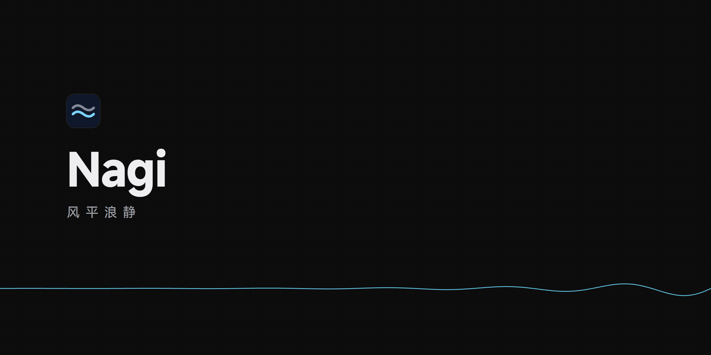
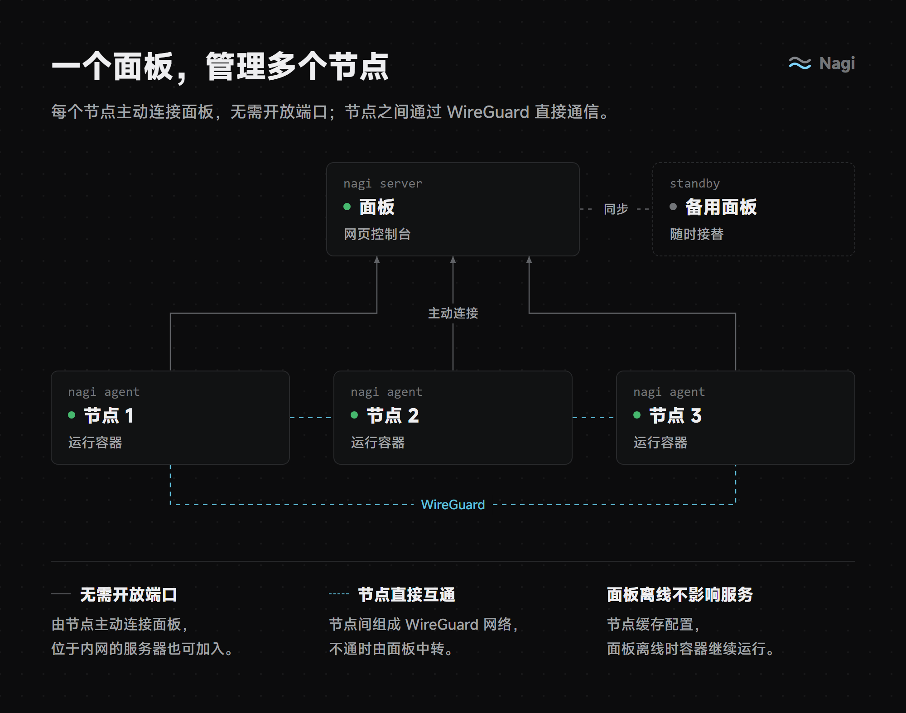
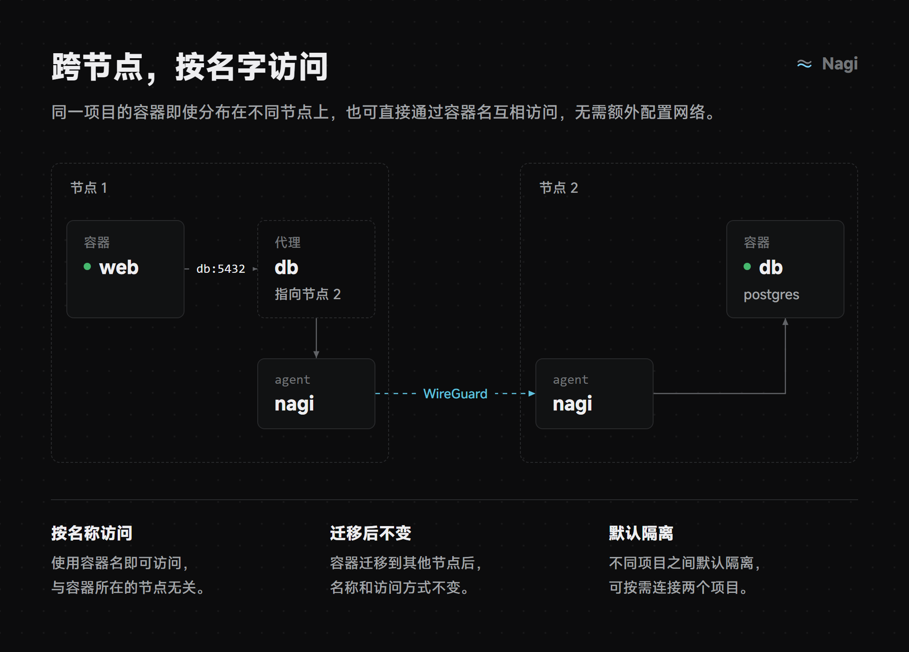
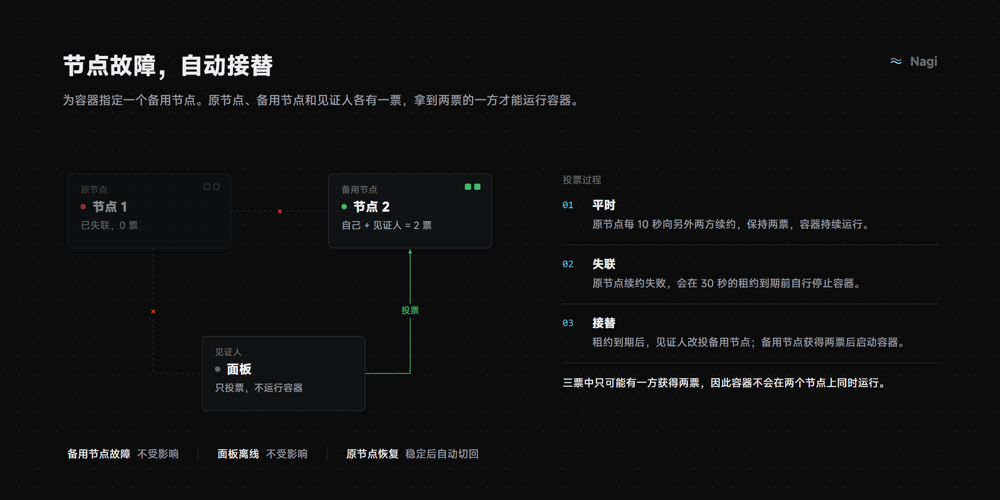
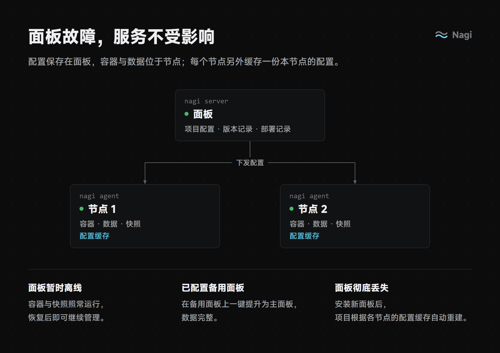
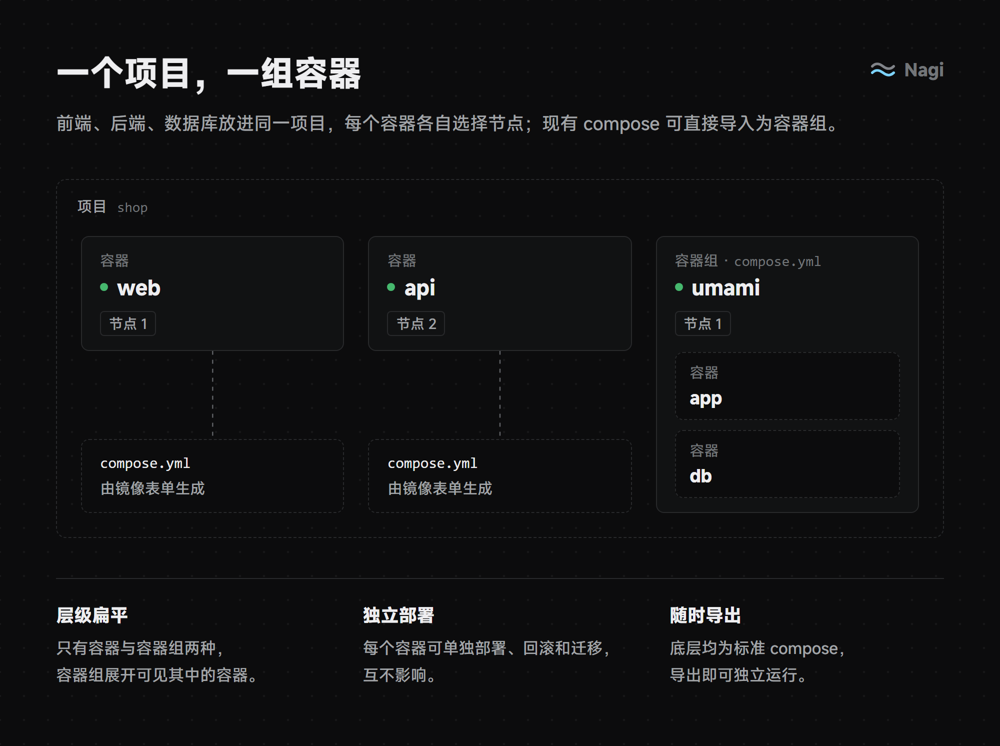
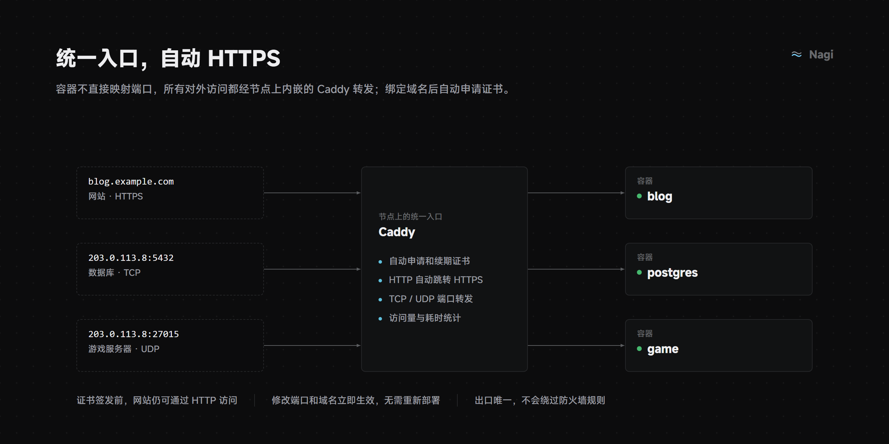
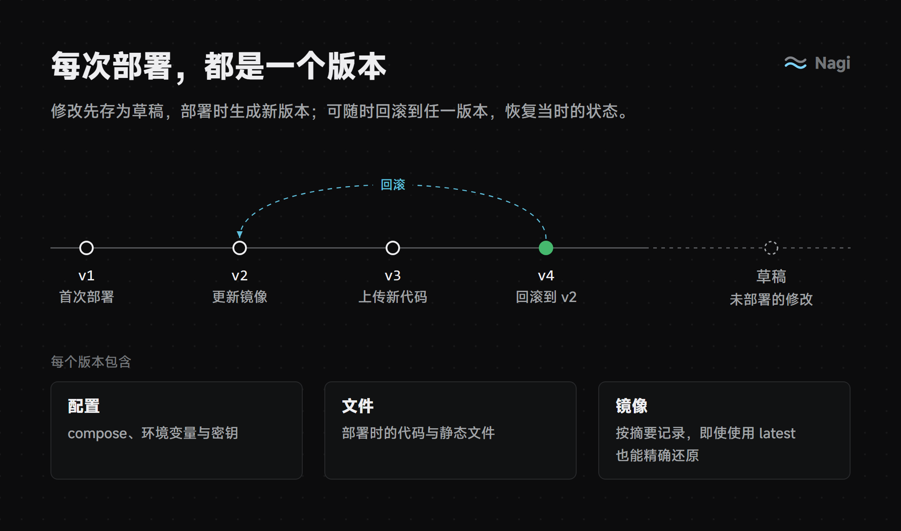
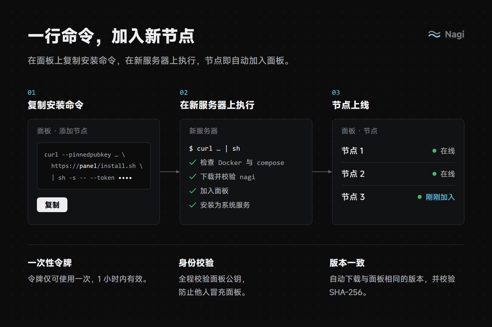

<p align="center"></p>

<p align="center">
  <a href="LICENSE"></a>
  
  
  
</p>

# Nagi（凪）

> 风平浪静。

Nagi 是一个开源的 Docker 项目面板，追求简单、美观、易于部署，可直接用于生产环境，并支持多节点与高可用。

> 状态：开发中，尚未发布。

## 特性















此外还支持：

- 日志、终端、监控与告警（webhook、Telegram），面板离线时告警照常发送
- 快照：按容器定时备份与恢复，可指定备份节点作为异地副本；容器可在节点间迁移，数据不丢失；节点彻底损坏时，可将容器重新部署到其他节点
- 环境变量（项目、容器组、容器三层）与密钥、私有镜像仓库认证、健康检查、资源限制
- 镜像更新提醒、国内节点镜像加速
- 项目之间默认隔离，可按需连接两个项目
- 主备面板，以及在面板之间移交节点
- 面板安全：可选两步验证、登录限速与安全入口；可在面板上一键升级节点

暂不支持：自动调度、单个容器多副本运行、多面板同时管理、多用户、恢复演练、接管已有项目、在节点上构建、应用模板。跨节点的容器之间仅转发 TCP。

## 快速开始

> 尚未发布，以下命令可能变更。

### 安装面板

在 Linux 服务器上以 root 执行：

```bash
curl -fsSL https://github.com/SIPC/Nagi/releases/latest/download/install.sh | sudo sh
```

脚本会下载 nagi 并校验 SHA-256，以 systemd 服务运行面板；面板默认内嵌一个节点，单机即可使用，未安装 Docker 时会自动安装。完成后终端会输出面板地址、公钥指纹和初始化链接，在浏览器中打开链接即可设置管理员账号。面板使用自签证书，浏览器提示不安全时，核对公钥指纹后继续即可。

常用选项（追加在命令末尾，例如 `| sudo sh -s -- --port 28443`）：

| 选项 | 说明 |
| --- | --- |
| `--port <端口>` | 指定面板端口，默认首次启动时随机选择 |
| `--no-agent` | 只运行面板，不内嵌节点，适合把面板单独放在一台机器上 |
| `--docker-mirror <名称>` | 自动安装 Docker 时使用的软件源镜像：`Aliyun` 或 `AzureChinaCloud`，适用于国内服务器 |
| `--download-url <地址>` | 从镜像或内网地址下载 nagi，适用于无法访问 GitHub 的环境 |
| `--version <版本>` | 安装指定版本，默认为最新版本 |

### 添加节点

在面板的「节点」页复制安装命令，在新服务器上以 root 执行。节点同样会自动安装 Docker。



### 添加备用面板

在主面板「设置 → 备用面板」中生成配对码，在新服务器上执行：

```bash
curl -fsSL https://github.com/SIPC/Nagi/releases/latest/download/install.sh | sudo sh -s -- --standby <配对码>
```

主面板故障时，可在备用面板上将其提升为主面板。

### 升级

再次执行安装脚本即可升级面板，端口、数据目录等配置保持不变；节点可在面板的「节点」页一键升级。

### 卸载

面板和节点通用：

```bash
curl -fsSL https://github.com/SIPC/Nagi/releases/latest/download/uninstall.sh | sudo sh
```

默认只卸载程序和服务，项目容器与 Nagi 数据目录保留；加 `-s -- --purge` 会同时删除 Nagi 管理的容器、网络和数据目录。项目文件（容器目录，默认在 `/srv/nagi` 下）不会被删除，脚本执行完会列出它们的位置。Docker 本身不卸载。卸载节点前，建议先在面板上迁移或删除它的容器。

### 更换面板

在新面板上生成接入码，粘贴到旧面板即可移交节点，新面板根据节点缓存自动重建项目（草稿与历史版本记录不会保留）。若旧面板已不可用，可在节点上执行：

```bash
nagi panel add <接入码>
nagi panel remove <旧面板地址>
```

## 系统要求

- Linux（amd64 / arm64），建议使用 systemd
- Docker 与 compose 插件 2.24 及以上版本（安装脚本会自动安装）
- 需要放行的端口：

| 端口 | 协议 | 用途 |
| --- | --- | --- |
| 面板端口 | TCP、UDP | 网页控制台与节点连接，需能被浏览器和所有节点访问；UDP 用于 WireGuard 中转 |
| 80、443 | TCP | 项目域名访问与证书申请，仅在通过域名对外提供服务的节点上需要 |
| 节点的 WireGuard 端口 | UDP | 节点之间直连，首次启动时随机选择；未放行时自动经面板中转 |

此外，在界面上为容器开放的 TCP / UDP 端口也需要在对应节点上放行。

## 架构

只有一个二进制 `nagi`：`nagi server` 为面板，`nagi agent` 为节点。

- **控制面**：节点以 mTLS 主动连接面板，无需开放入站端口；单条连接经 yamux 多路复用，面板通过反向 gRPC 调用节点。面板使用自签 CA，节点以公钥指纹校验面板身份。
- **数据面**：节点之间基于用户态 wireguard-go 组成全互联网络，地址由公钥派生；直连不可达时依次回退至面板 UDP 中继与 TLS 中继。
- **授权**：网络连通不代表有权访问，每次调用均按调用方公钥单独鉴权。

各模块的详细设计见 [设计文档](docs/README.md)。

## 参与开发

- 后端：Go、gRPC、Connect-RPC、SQLite（modernc）
- 前端：Vite、React、TypeScript、TanStack Router / Query、shadcn/ui

从源码构建与本地开发见 [开发规划](docs/development.md#本地开发)。

## 安全

请勿通过公开的 issue 报告安全问题，报告方式见 [SECURITY.md](SECURITY.md)。

## 致谢

Nagi 构建在以下开源项目之上：

- [Caddy](https://github.com/caddyserver/caddy) 与 [caddy-l4](https://github.com/mholt/caddy-l4)：对外访问、自动 HTTPS 与 TCP / UDP 转发
- [wireguard-go](https://git.zx2c4.com/wireguard-go)：节点之间的加密网络
- [kopia](https://github.com/kopia/kopia)：快照与异地副本
- [yamux](https://github.com/hashicorp/yamux)、[Connect](https://connectrpc.com)：控制面通信
- [shadcn/ui](https://ui.shadcn.com)：界面组件

## 许可证

[Apache-2.0](LICENSE)
