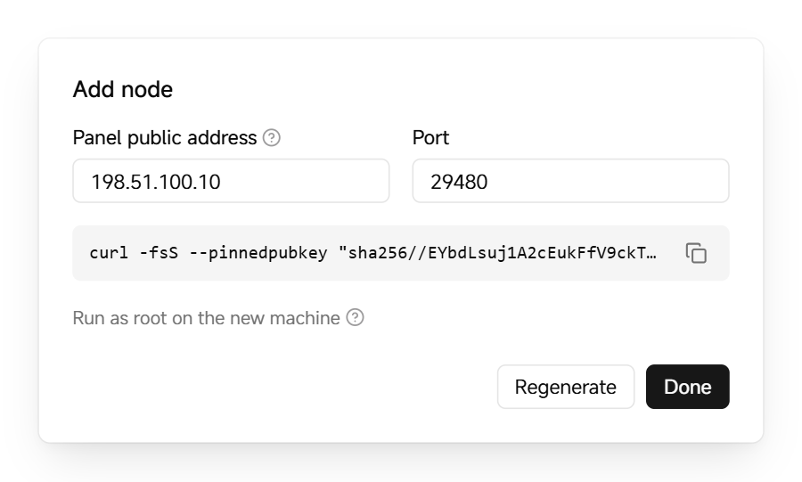

# Add a node

A node is a Linux server that runs containers. After you add a node, you can deploy containers in your projects to it. Nodes connect out to the panel, so they don't need inbound ports.

Before you start, make sure the new server meets the [requirements](../../README.en.md#requirements) and can reach the panel's address and port.

## Add a node

1. In the sidebar of the panel, click **Nodes**, then click **Add node**.

2. Make sure **Panel public address** is an address the new server can reach. To change it, edit the address and click **Save**.

3. Click **Generate install command**, then click the copy button next to the command.

   <picture>
     <source media="(prefers-color-scheme: dark)" srcset="../assets/guide/add-node.en.dark.png">
     
   </picture>

   Each install command can be used once and is valid for 1 hour. To add several servers, generate a command for each one.

4. Run the command as root on the new server.

   The script downloads the same nagi version as the panel from GitHub Releases and verifies its SHA-256. If Docker isn't installed, the script installs it.

   If the server can't reach GitHub, append `--download-url <mirror-url>` to the command. Upgrades of this node from the panel then download from the same address.

When the command finishes, the new node appears on the **Nodes** page as **Online**.

Next: [Add a standby panel](standby.en.md) so you can keep managing nodes and projects if the primary panel fails.
