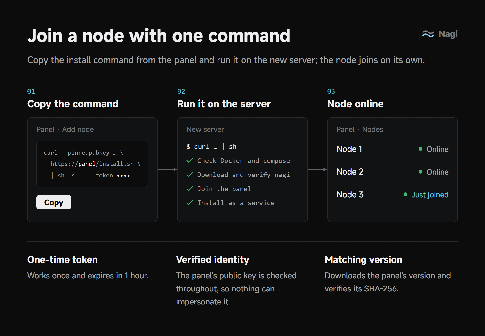

# Add a node

Copy the install command from the **Nodes** page in the panel and run it as root on the new server. The script downloads the same nagi version as the panel from GitHub Releases, verifies its SHA-256 and installs Docker if needed.

If GitHub is unreachable, append `--download-url <mirror>`; one-click upgrades from the panel will use the same address later.

