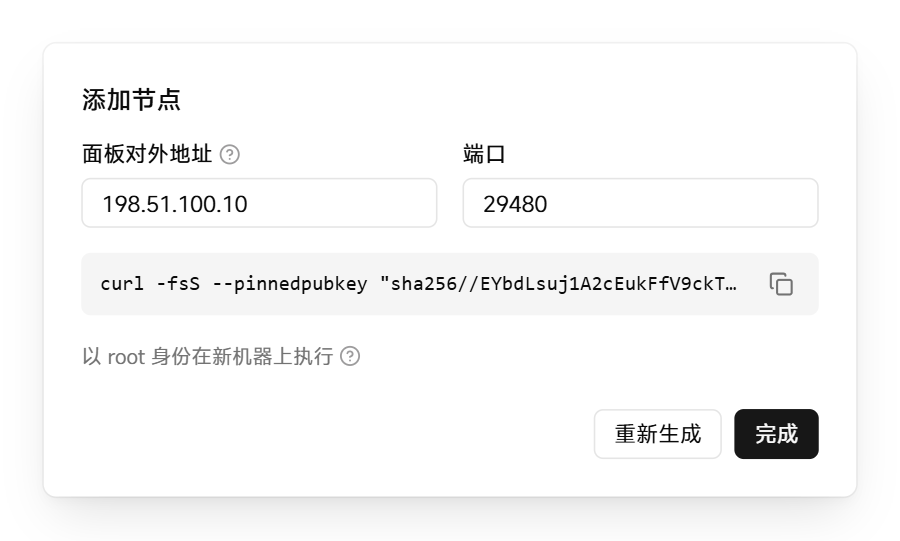

# 添加节点

节点是运行容器的 Linux 服务器。添加节点后，可以把项目中的容器部署到这台服务器上。节点主动连接面板，不需要开放入站端口。

开始前，确认新服务器满足 [系统要求](../../README.md#系统要求)，并能访问面板的地址和端口。

## 添加节点

1. 在面板左侧的导航中点击「节点」，然后点击「添加节点」。

2. 确认「面板对外地址」是新服务器可以访问的地址。如果需要更改，编辑后点击「保存」。

3. 点击「生成安装命令」，然后点击命令右侧的复制按钮。

   <picture>
     <source media="(prefers-color-scheme: dark)" srcset="../assets/guide/add-node.dark.png">
     
   </picture>

   每条安装命令只能使用一次，有效期 1 小时。添加多台服务器时，为每台分别生成命令。

4. 在新服务器上以 root 身份执行该命令。

   安装脚本从 GitHub Releases 下载与面板相同版本的 nagi 并校验 SHA-256。如果服务器没有安装 Docker，脚本会自动安装。

   如果服务器无法访问 GitHub，在命令末尾加上 `--download-url <镜像地址>`。之后在面板上升级该节点时，也从这个地址下载。

命令执行完成后，新节点出现在「节点」页，状态为「在线」。

下一步：[添加备用面板](standby.md)，主面板故障时可以继续管理节点和项目。
