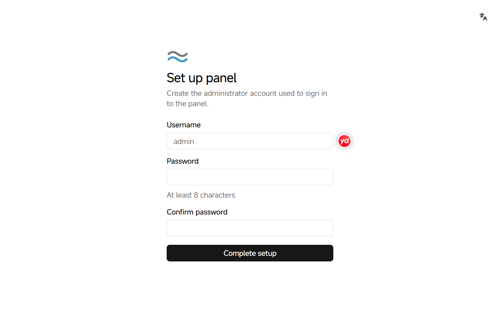

# Install the panel

The panel is the web console you use to manage nodes and projects. It includes a built-in node by default, so after installation you can start deploying containers on a single server.

Before you start, make sure the server meets the [requirements](../../README.en.md#requirements), and sign in to it as root.

## Install and set up the panel

1. Run this command on the server:

   ```bash
   curl -fsSL https://github.com/SIPC/Nagi/releases/latest/download/install.sh | sudo sh
   ```

   The script downloads nagi, verifies its SHA-256 and runs the panel as a systemd service. If Docker isn't installed, the script installs it.

2. When the installation finishes, the script prints the panel address, the public key fingerprint and a setup link. Open the setup link in a browser.

   The panel uses a self-signed certificate, so the browser warns that the connection isn't secure. Check the public key fingerprint printed by the script, then continue. The setup link is valid for 24 hours.

3. Enter a username and password for the administrator, then click **Complete setup**.

   <picture>
     <source media="(prefers-color-scheme: dark)" srcset="../assets/guide/setup.en.dark.png">
     
   </picture>

When setup is complete, the panel signs you in as the administrator.

## Installation options

To change how the panel is installed, append these options to the command, for example `| sudo sh -s -- --port 28443`.

| Option | Description |
| --- | --- |
| `--port <port>` | Sets the panel port. By default, a port is picked at random on first start |
| `--no-agent` | Runs only the panel, without a built-in node. Use it to run the panel on a server of its own |
| `--docker-mirror <name>` | Sets the package mirror used to install Docker: `Aliyun` or `AzureChinaCloud`. Use it for servers in mainland China |
| `--download-url <url>` | Downloads nagi from a mirror or internal address. Use it when GitHub is unreachable; updates from the panel also download from this address |
| `--version <version>` | Installs a specific version. By default, the latest version is installed |

Next: [Add a node](add-node.en.md).
