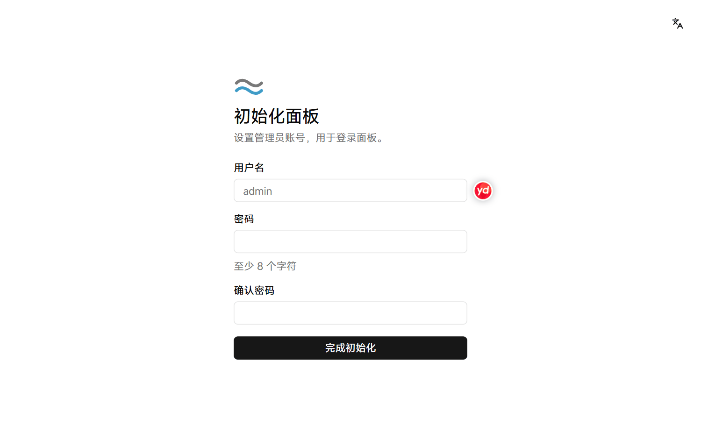

# 安装面板

面板是管理节点和项目的网页控制台。面板默认内嵌一个节点，安装后一台服务器即可开始部署容器。

开始前，确认服务器满足 [系统要求](../../README.md#系统要求)，并以 root 身份登录服务器。

## 安装并初始化面板

1. 在服务器上执行以下命令：

   ```bash
   curl -fsSL https://github.com/SIPC/Nagi/releases/latest/download/install.sh | sudo sh
   ```

   安装脚本下载 nagi 并校验 SHA-256，以 systemd 服务运行面板。如果服务器没有安装 Docker，脚本会自动安装。

2. 安装完成后，终端输出面板地址、公钥指纹和初始化链接。在浏览器中打开初始化链接。

   面板使用自签证书，浏览器会提示连接不安全。核对终端输出的公钥指纹后继续访问。初始化链接 24 小时内有效。

3. 输入管理员的用户名和密码，然后点击「完成初始化」。

   <picture>
     <source media="(prefers-color-scheme: dark)" srcset="../assets/guide/setup.dark.png">
     
   </picture>

初始化完成后，面板自动登录管理员账号。

## 安装选项

在命令末尾追加以下选项，可以调整安装方式，例如 `| sudo sh -s -- --port 28443`。

| 选项 | 说明 |
| --- | --- |
| `--port <端口>` | 指定面板端口。默认在首次启动时随机选择 |
| `--no-agent` | 只运行面板，不内嵌节点。适用于把面板单独放在一台服务器上 |
| `--docker-mirror <名称>` | 自动安装 Docker 时使用的软件源镜像：`Aliyun` 或 `AzureChinaCloud`。适用于中国大陆的服务器 |
| `--download-url <地址>` | 从镜像或内网地址下载 nagi。适用于无法访问 GitHub 的环境；之后在面板上更新时也从该地址下载 |
| `--version <版本>` | 安装指定版本。默认安装最新版本 |

下一步：[添加节点](add-node.md)。
