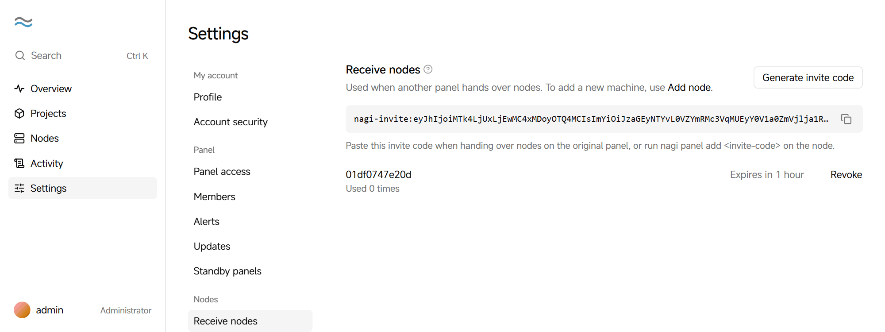
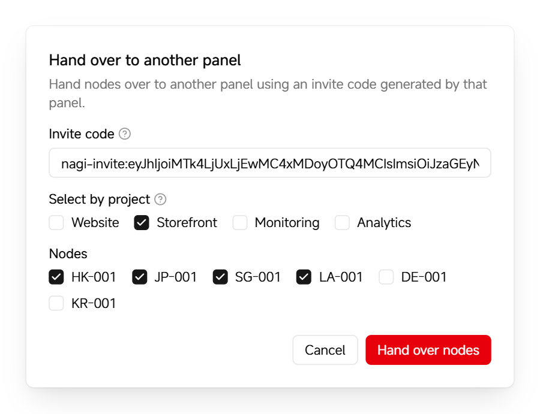

# Switch panels

You can hand nodes over from an old panel to a new one. The new panel rebuilds the projects from the configuration cached on the nodes, and project containers keep running. Drafts and version history aren't kept.

Before you start, [install the panel](install.en.md) on the new server.

## Hand over nodes

1. In the new panel, click **Settings → Receive nodes**, then click **Generate invite code**.

2. Click the copy button next to the invite code.

   <picture>
     <source media="(prefers-color-scheme: dark)" srcset="../assets/guide/invite.en.dark.png">
     
   </picture>

   The invite code is valid for 1 hour and can be used by several nodes.

3. In the sidebar of the old panel, click **Nodes**, click the **More actions** button (⋯) in the upper-right corner of the page, then choose **Hand over to another panel**.

4. Paste the invite code, select the projects or nodes to hand over, then click **Hand over nodes**.

   <picture>
     <source media="(prefers-color-scheme: dark)" srcset="../assets/guide/handover.en.dark.png">
     
   </picture>

   Nodes are handed over by project. When you select a project, the panel also selects the nodes its containers run on and its backup, failover and witness nodes.

5. Read the confirmation, then click **Hand over nodes**.

6. On the **Nodes** page of the new panel, click **Approve** for each node that was handed over, then click **Approve** in the confirmation.

   Nodes that join with an invite code must be approved before you can use them, in case the code leaks.

When the handover is complete, the old panel no longer manages these nodes, and the new panel shows the projects rebuilt from them.

## If the old panel is unreachable

If the old panel is no longer reachable, generate an invite code on the new panel, then run these commands as root on each node:

```bash
nagi panel add <invite-code>
nagi panel remove <old-panel-address>
```

Then approve the nodes on the **Nodes** page of the new panel.
