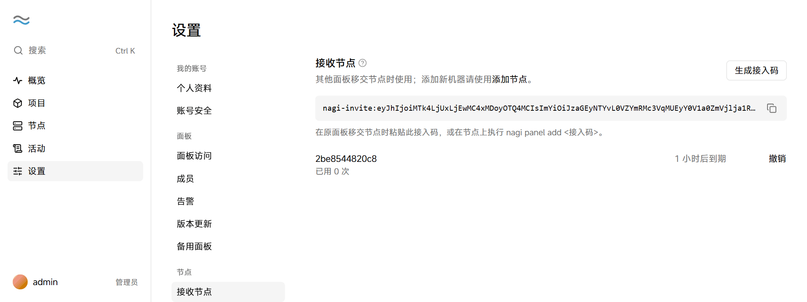
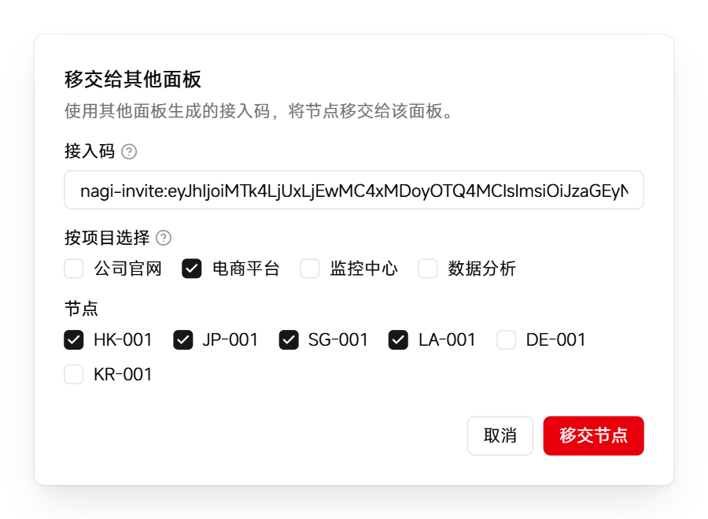

# 更换面板

可以把节点从旧面板移交给新面板。新面板根据节点上缓存的配置重建项目，项目容器照常运行。草稿和历史版本记录不会保留。

开始前，在新服务器上 [安装面板](install.md)。

## 移交节点

1. 在新面板中点击「设置 → 接收节点」，然后点击「生成接入码」。

2. 点击接入码右侧的复制按钮。

   <picture>
     <source media="(prefers-color-scheme: dark)" srcset="../assets/guide/invite.dark.png">
     
   </picture>

   接入码 1 小时内有效，可以供多个节点使用。

3. 在旧面板左侧的导航中点击「节点」，点击页面右上角的「更多操作」按钮（⋯），然后选择「移交给其他面板」。

4. 粘贴接入码，选择要移交的项目或节点，然后点击「移交节点」。

   <picture>
     <source media="(prefers-color-scheme: dark)" srcset="../assets/guide/handover.dark.png">
     
   </picture>

   移交以项目为单位。选择项目时，面板同时选中该项目的容器所在节点、备份节点、顶替节点和见证人节点。

5. 阅读确认框中的说明，然后点击「移交节点」。

6. 在新面板的「节点」页，为每个移交过来的节点点击「批准」，然后在确认框中点击「批准」。

   通过接入码加入的节点需要批准后才能使用，以防接入码泄露后被他人利用。

移交完成后，旧面板不再管理这些节点，新面板显示从节点重建的项目。

## 旧面板无法访问时

如果旧面板已经无法访问，在新面板上生成接入码后，在每个节点上以 root 身份执行以下命令：

```bash
nagi panel add <接入码>
nagi panel remove <旧面板地址>
```

然后在新面板的「节点」页批准这些节点。
