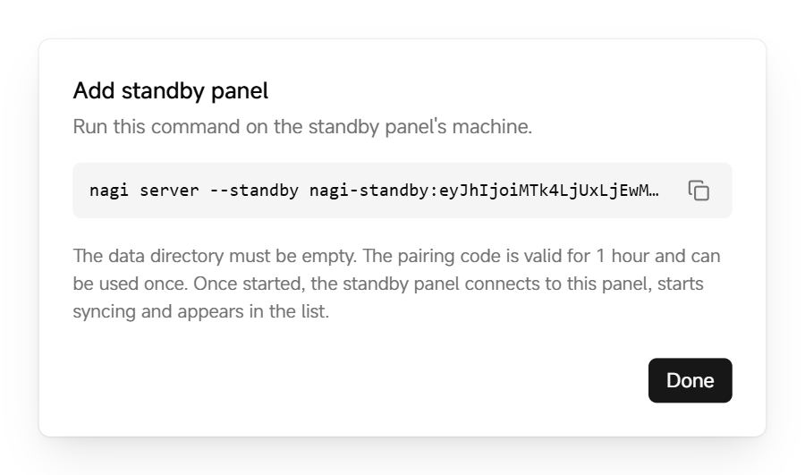

# Add a standby panel

A standby panel keeps an up-to-date copy of the primary panel's data and is read-only. If the primary panel fails, you can promote the standby panel to primary and keep managing nodes and projects.

Before you start, prepare a server that meets the [requirements](../../README.en.md#requirements), make sure it can reach the primary panel's address and port, and sign in to it as root. Standby panels don't include a built-in node.

## Add a standby panel

1. In the primary panel, click **Settings → Standby panels**, then click **Add standby panel**.

2. Copy the pairing code after `--standby` in the dialog. It starts with `nagi-standby:`.

   <picture>
     <source media="(prefers-color-scheme: dark)" srcset="../assets/guide/standby.en.dark.png">
     
   </picture>

   The pairing code is valid for 1 hour and can be used once.

3. Run this command on the new server, replacing `<pairing-code>` with the code you copied:

   ```bash
   curl -fsSL https://github.com/SIPC/Nagi/releases/latest/download/install.sh | sudo sh -s -- --standby <pairing-code>
   ```

Once started, the standby panel connects to the primary panel, starts syncing and appears under **Settings → Standby panels** on the primary panel.

## Promote to primary

1. In the standby panel, click **Settings → Standby panels**, then click **Promote to primary**.
2. Read the confirmation, then click **Promote to primary**.

After promotion, nodes accept changes only from the new primary panel, and other standby panels sync from it. When the old primary panel comes back, it becomes a standby panel automatically.

> **Warning**: Don't promote a standby panel while the primary panel is still running, or the two panels may make conflicting changes. Changes made on the old primary panel in its last few seconds that weren't synced are lost.
