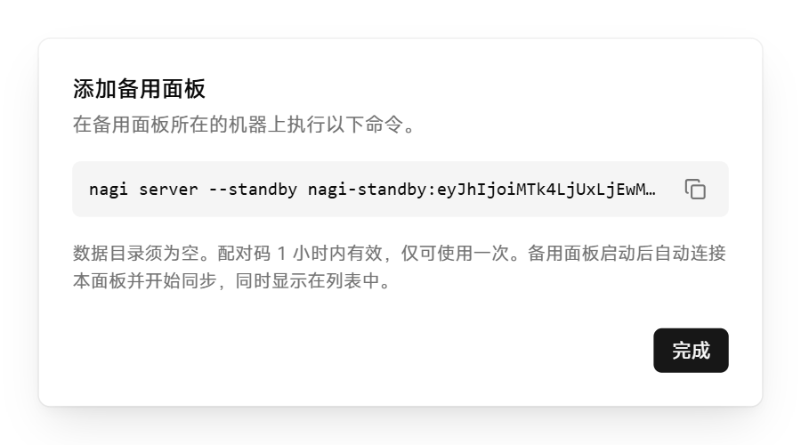

# 添加备用面板

备用面板实时同步主面板的数据，平时只读。主面板故障时，可以在备用面板上将其提升为主面板，继续管理节点和项目。

开始前，准备一台满足 [系统要求](../../README.md#系统要求) 的服务器，确认它能访问主面板的地址和端口，并以 root 身份登录。备用面板不内嵌节点。

## 添加备用面板

1. 在主面板中点击「设置 → 备用面板」，然后点击「添加备用面板」。

2. 复制对话框中 `--standby` 之后的配对码（以 `nagi-standby:` 开头）。

   <picture>
     <source media="(prefers-color-scheme: dark)" srcset="../assets/guide/standby.dark.png">
     
   </picture>

   配对码 1 小时内有效，只能使用一次。

3. 在新服务器上执行以下命令，把 `<配对码>` 换成上一步复制的配对码：

   ```bash
   curl -fsSL https://github.com/SIPC/Nagi/releases/latest/download/install.sh | sudo sh -s -- --standby <配对码>
   ```

备用面板启动后自动连接主面板并开始同步，出现在主面板的「设置 → 备用面板」列表中。

## 提升为主面板

1. 在备用面板中点击「设置 → 备用面板」，然后点击「提升为主面板」。
2. 阅读确认框中的说明，然后点击「提升为主面板」。

提升后，节点只接受新主面板的修改，其他备用面板改为从新主面板同步。原主面板恢复后自动降为备用面板。

> **警告**：主面板仍在运行时不要提升备用面板，否则两个面板可能产生不一致的修改。原主面板最后几秒内未同步的修改会丢失。
