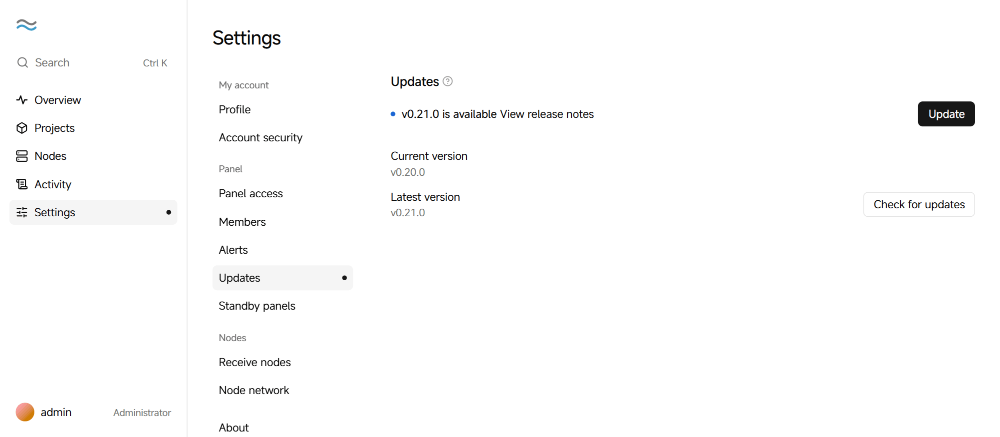

# Upgrade and uninstall

You can update the panel and upgrade nodes with one click in the panel, or run the install script again. By default, the uninstall script removes only the program and services, and keeps project containers and data.

## Update the panel

1. In the panel, click **Settings → Updates**.

2. If a new version is available, click **Update**, then click **Update panel** in the confirmation.

   <picture>
     <source media="(prefers-color-scheme: dark)" srcset="../assets/guide/update.en.dark.png">
     
   </picture>

The panel downloads and verifies the new version, then restarts in place. The page is interrupted for a few seconds and reloads automatically. Project containers keep running.

If you have standby panels, update each of them separately. While the versions differ, a standby panel pauses syncing until both are on the same version.

You can also run the install command on the server again to update the panel. The port, data directory and other settings stay the same.

## Upgrade nodes

After the panel is updated, nodes on an older version show **Upgrade available** on the **Nodes** page.

1. In the sidebar of the panel, click **Nodes**.
2. Click **Upgrade all nodes**, then click **Upgrade all** in the confirmation.

Nodes download and verify the same version as the panel one at a time, then restart in place. Containers keep running during the upgrade, and the built-in Caddy is interrupted for a second or two.

To upgrade a single node, open the node's page, then click **Upgrade**.

## Uninstall

Panels and nodes use the same uninstall script. Before you uninstall a node, move or delete its containers in the panel.

Run this command as root on the server:

```bash
curl -fsSL https://github.com/SIPC/Nagi/releases/latest/download/uninstall.sh | sudo sh
```

The script removes the program and services, and keeps project containers and the Nagi data directory. Project files (container directories, under `/srv/nagi` by default) aren't deleted; the script lists where they are when it finishes. Docker isn't uninstalled.

To also remove the containers, networks and data directory managed by Nagi, append `-s -- --purge` to the command:

```bash
curl -fsSL https://github.com/SIPC/Nagi/releases/latest/download/uninstall.sh | sudo sh -s -- --purge
```

> **Warning**: Containers and data removed with `--purge` can't be recovered.
