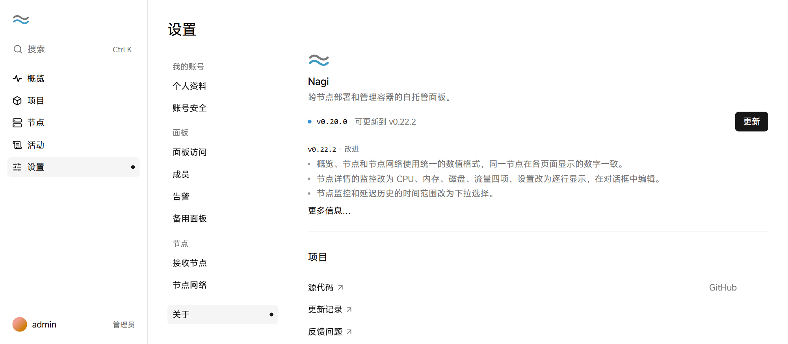

# 升级与卸载

可以在面板上一键更新面板和升级节点，也可以再次执行安装脚本升级。卸载脚本默认只删除程序和服务，保留项目容器和数据。

## 更新面板

1. 在面板中点击「设置 → 关于」。

2. 如果有新版本，点击「更新」，然后在确认框中点击「更新面板」。

   <picture>
     <source media="(prefers-color-scheme: dark)" srcset="../assets/guide/update.dark.png">
     
   </picture>

面板下载并校验新版本后原地重启，页面中断几秒后自动刷新。项目容器照常运行。

如果有备用面板，需要在每个备用面板上分别更新。两边版本不同时，备用面板暂停同步，直到更新到同一版本。

也可以在服务器上再次执行安装命令更新面板，端口、数据目录等配置保持不变。

## 升级节点

面板更新后，版本较低的节点在「节点」页显示「可升级」。

1. 在面板左侧的导航中点击「节点」。
2. 点击「升级全部节点」，然后在确认框中点击「升级全部」。

节点逐个下载并校验与面板相同的版本，完成后原地重启。升级期间容器照常运行，内置的 Caddy 会中断一两秒。

要只升级一个节点，打开该节点的页面，然后点击「升级」。

## 卸载

面板和节点使用同一个卸载脚本。卸载节点前，先在面板上迁移或删除该节点上的容器。

在服务器上以 root 身份执行以下命令：

```bash
curl -fsSL https://github.com/SIPC/Nagi/releases/latest/download/uninstall.sh | sudo sh
```

脚本删除程序和服务，保留项目容器和 Nagi 数据目录。项目文件（容器目录，默认在 `/srv/nagi` 下）不会删除，脚本完成后列出它们的位置。Docker 不会卸载。

要同时删除 Nagi 管理的容器、网络和数据目录，在命令末尾加上 `-s -- --purge`：

```bash
curl -fsSL https://github.com/SIPC/Nagi/releases/latest/download/uninstall.sh | sudo sh -s -- --purge
```

> **警告**：使用 `--purge` 删除的容器和数据无法恢复。
